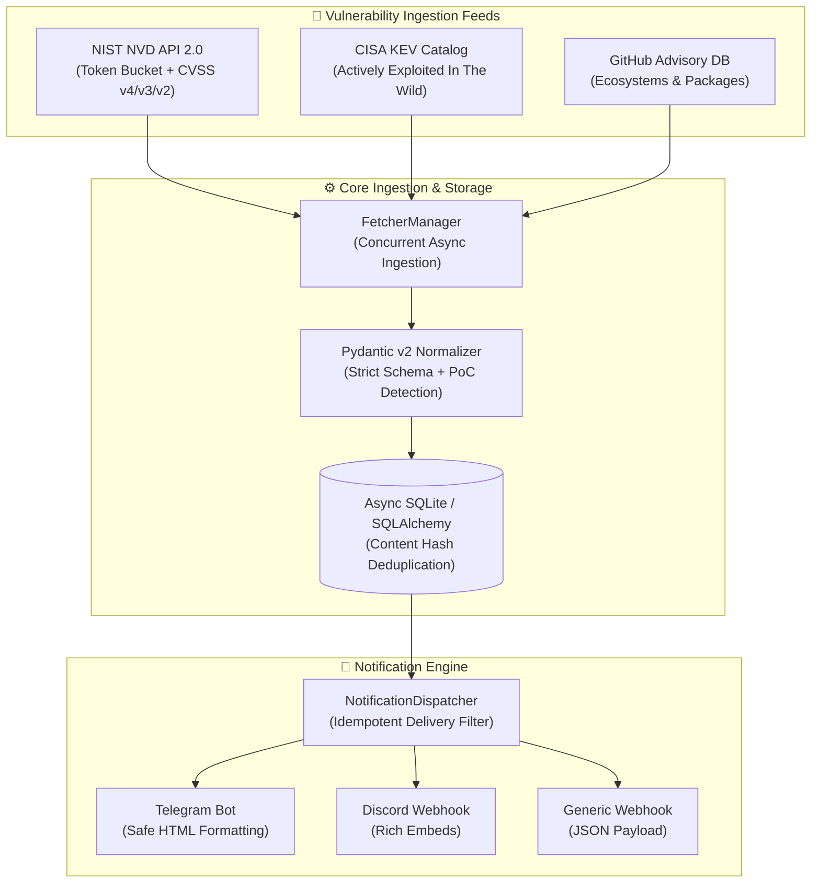

# 🛡️ CVE Tracker Bot v2.0

<p align="center">
  
</p>

<p align="center">
  <b>Production-Grade Asynchronous Vulnerability Intelligence & Multi-Channel Alerting System</b>
</p>

<p align="center">
  
  
  
  
  
</p>

---

## 🌟 Overview

**CVE Tracker Bot v2.0** is an enterprise-ready, asynchronous vulnerability monitoring agent built from the ground up to ingest, normalize, filter, and dispatch real-time CVE and 0-day alerts.

It tracks multiple authoritative feeds simultaneously—**NIST NVD API 2.0**, **CISA KEV (Known Exploited Vulnerabilities)**, and **GitHub Security Advisories (GHSA)**—and distributes tailored alerts across **Telegram**, **Discord**, and **Generic Webhooks** without alert fatigue, message dropping, or duplicate notifications.

---

## 🏗️ System Architecture



---

## ✨ Key Capabilities

- **Multi-Source Aggregation**:
  - **NIST NVD API 2.0**: Native support for CVSS v4.0, v3.1, v3.0, and v2.0, CPE vendor/product extraction, and CWE mapping.
  - **CISA KEV**: Real-time alerts on vulnerabilities actively being exploited in ransomware campaigns and targeted attacks.
  - **GitHub Security Advisories (GHSA)**: Immediate alerts for npm, PyPI, Maven, Go, and Cargo dependencies.
- **Resilient Concurrency & Rate Limiting**:
  - Independent **Token Bucket** throttlers for each source.
  - Exponential backoff with random jitter for HTTP `429 (Too Many Requests)` and transient `503 Service Unavailable` failures.
- **Strict Data Integrity**:
  - Built on **Pydantic v2** models with strict schema validation.
  - No `KeyError` or crashes from missing API fields.
- **Guaranteed Idempotency & Zero Duplication**:
  - State tracked via transactional SQLite with `content_hash` change detection.
  - An alert is delivered to a subscriber **once and only once** unless its severity or CVSS score is meaningfully updated upstream.
- **Multi-Platform Delivery**:
  - **Telegram**: Safe HTML formatting (`html.escape()`) avoiding MarkdownV2 syntax crashes, menu wizard, and inline navigation keyboards.
  - **Discord**: Color-coded rich embeds categorized by severity.
  - **Generic Webhook**: Standardized JSON payloads for SIEM, Slack, Microsoft Teams, or Kafka pipelines.
- **Zero-Downtime Legacy Migration**:
  - Automatically migrates existing `subscribers.json` and `filters.json` into SQLite on first launch.

---

## 📂 Project Structure

```
CVETrackerBot/
├── cve_tracker/
│   ├── core/                  # Config, logging, exceptions, token bucket limiter
│   │   ├── config.py
│   │   ├── exceptions.py
│   │   ├── logging.py
│   │   └── rate_limiter.py
│   ├── fetchers/              # External vulnerability API clients
│   │   ├── base.py
│   │   ├── cisa_kev.py
│   │   ├── github.py
│   │   ├── manager.py
│   │   └── nvd.py
│   ├── models/                # Pydantic v2 domain schemas & filters
│   │   ├── cve.py
│   │   ├── filter.py
│   │   └── subscriber.py
│   ├── notifiers/             # Telegram, Discord, and Webhook dispatchers
│   │   ├── base.py
│   │   ├── discord.py
│   │   ├── dispatcher.py
│   │   ├── telegram.py
│   │   └── webhook.py
│   ├── storage/               # Async SQLAlchemy engine & repository
│   │   ├── database.py
│   │   ├── models.py
│   │   └── repository.py
│   ├── bot/                   # Telegram bot service, handlers & menus
│   │   ├── handlers.py
│   │   ├── keyboards.py
│   │   └── service.py
│   └── main.py                # Application entrypoint & worker lifecycle
├── tests/                     # Comprehensive async test suite
├── Dockerfile                 # Multi-stage non-root production container
├── docker-compose.yml         # Container orchestration with persistent volume
├── pyproject.toml             # Project metadata & test configuration
└── requirements.txt           # Pinned production dependencies
```

---

## ⚙️ Configuration (.env)

Copy the template to create your `.env` file:

```bash
cp .env.example .env
```

| Parameter | Required | Default | Description |
| :--- | :---: | :---: | :--- |
| `TELEGRAM_BOT_TOKEN` | Optional* | `None` | Telegram bot token from [@BotFather](https://t.me/BotFather). (*Required for Telegram bot) |
| `NVD_API_KEY` | Optional | `None` | NVD API Key. Boosts rate limit from 5 req/30s to 50 req/30s. |
| `GITHUB_TOKEN` | Optional | `None` | GitHub Personal Access Token to avoid unauthenticated API rate limits. |
| `DATABASE_URL` | No | `sqlite+aiosqlite:///data/cve_tracker.db` | Async SQLAlchemy database connection string. |
| `POLL_INTERVAL_SECONDS`| No | `3600` | Automated polling frequency in seconds (default 1h). |
| `DEFAULT_MIN_CVSS` | No | `6.0` | Global minimum CVSS threshold (0.0 to 10.0). |
| `DISCORD_WEBHOOK_URL` | Optional | `None` | Global Discord webhook for broadcasting alerts. |
| `GENERIC_WEBHOOK_URL` | Optional | `None` | Global HTTP webhook for JSON streaming. |
| `LOG_LEVEL` | No | `INFO` | Logging level (`DEBUG`, `INFO`, `WARNING`, `ERROR`). |
| `LOG_JSON` | No | `false` | Enable structured JSON logging for cloud log collectors. |

---

## 🚀 Quickstart & Local Setup

### 1. Requirements
- Python 3.11+
- Virtual environment tool (`venv`)

### 2. Installation
```bash
git clone https://github.com/Liamsa1212/CVETrackerBot.git
cd CVETrackerBot

python -m venv .venv
source .venv/bin/activate  # On Windows: .venv\Scripts\activate

pip install -r requirements.txt
```

### 3. Launch the Bot
```bash
python -m cve_tracker.main
# Or: python bot.py
```

---

## 🐳 Docker Deployment

The application includes a hardened, multi-stage `Dockerfile` running as an unprivileged user (`appuser` UID 10001).

### Using Docker Compose (Recommended)

```bash
# 1. Configure environment
cp .env.example .env
nano .env

# 2. Build and start container in background
docker compose up -d --build

# 3. View live logs
docker compose logs -f
```

---

## 🤖 Telegram Bot Commands

| Command | Description |
| :--- | :--- |
| `/start` | Launch interactive navigation menu |
| `/latest` | Fetch the 5 most recent vulnerabilities matching criteria |
| `/cisa` | Fetch recent actively exploited zero-days (CISA KEV) |
| `/subscribe` | Subscribe chat or channel to real-time alerts |
| `/unsubscribe` | Unsubscribe chat from alerts |
| `/filters` | View current active filters (Vendors, Keywords, Min CVSS, CWE) |
| `/setminscore <score>` | Set minimum CVSS threshold (e.g. `/setminscore 7.5`) |
| `/addfilter <type> <val>` | Add filter (e.g. `/addfilter vendor microsoft` or `/addfilter keyword rce`) |
| `/clearfilters` | Reset all filters to default |
| `/help` | Display command guide |

---

## 🧪 Testing

The codebase includes an async unit and integration test suite using `pytest`, `pytest-asyncio`, and `respx` for mock HTTP responses.

Run all tests:
```bash
pytest -v
```

---

## 🔒 Security Best Practices

- **Zero Hardcoded Secrets**: All tokens, credentials, and API keys are loaded via environment variables using `pydantic-settings`.
- **Non-Root Container**: Dockerfile executes under UID 10001 (`appuser`) with `no-new-privileges` enabled.
- **Output Sanitization**: All Telegram alert outputs are escaped using `html.escape()` to prevent HTML entity injection and formatting crashes.
- **Defensive API Ingestion**: Payload fields are validated before storage; malformed or missing fields cannot crash the service.

---

## 📄 License
MIT License. Developed and maintained for security engineers, SOC analysts, and DevOps teams.
